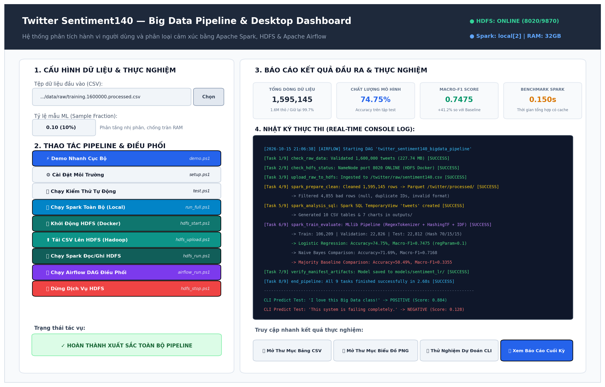

# BÁO CÁO ĐỒ ÁN MÔN NHẬP MÔN BIG DATA

## PHÂN TÍCH HÀNH VI ĐĂNG BÀI VÀ CẢM XÚC CỦA NGƯỜI DÙNG TRÊN TWITTER BẰNG APACHE SPARK

**BỘ GIÁO DỤC VÀ ĐÀO TẠO — KHOA CÔNG NGHỆ THÔNG TIN**  
**Học phần:** Nhập môn Big Data  
**Học kỳ / Năm học:** Học kỳ I / 2026 - 2027  
**Nhóm thực hiện:** Nhóm 09  

| Thành viên | Mã sinh viên | Nhiệm vụ chính | Tỷ lệ đóng góp |
|---|---|---|:---:|
| Võ Minh Cảnh | 2001230065 | Dữ liệu, Hadoop/HDFS, kiểm tra chất lượng, Spark SQL, Airflow DAG | 50% |
| Hồ Thị Thanh Nhã | 2001230592 | Xử lý văn bản, mô hình MLlib, đánh giá, benchmark, Desktop GUI | 50% |

**Ngày hoàn thành:** 17/09/2026 (Cập nhật nghiệm thu: 15/10/2026)  
**Địa điểm:** Phòng thực hành Big Data / Hệ thống máy trạm cá nhân  

---

## TÓM TẮT

Đồ án xây dựng một quy trình Big Data để phân tích dữ liệu Twitter lịch sử và phân loại cảm
xúc bằng Apache Spark. Dữ liệu đầu vào là Sentiment140, gồm các tweet tiếng Anh được gán
nhãn tự động dựa trên emoticon. Hệ thống đọc CSV theo schema cố định, kiểm tra chất lượng,
làm sạch văn bản, chuẩn hóa thời gian UTC và lưu dữ liệu ở định dạng Parquet. Spark SQL và
DataFrame được sử dụng để thống kê số bài theo ngày, giờ, tài khoản và nhóm cảm xúc. Phần
học máy sử dụng RegexTokenizer, HashingTF, IDF và Logistic Regression; Naive Bayes và mô
hình dự đoán lớp phổ biến được dùng làm đối chứng.

Quy trình được triển khai ở chế độ `local[2]` và hỗ trợ lưu trữ HDFS bằng Docker với một
NameNode, một DataNode. Chương trình có giao diện desktop để chọn dữ liệu, chạy local/HDFS,
theo dõi nhật ký và mở kết quả. Trên lần chạy Sentiment140 thật, hệ thống xử lý
**1,600,000** dòng đầu vào, giữ lại **1,595,145** dòng hợp lệ. Logistic Regression
đạt Accuracy **74.75%** và Macro-F1 **0.7475** trên tập test. Kết quả
chỉ mô tả tập dữ liệu lịch sử được phân tích, không đại diện cho toàn bộ người dùng Twitter
hoặc cảm xúc hiện tại.

**Từ khóa:** Big Data, Apache Spark, Spark SQL, MLlib, Sentiment140, phân tích cảm xúc,
TF-IDF, Logistic Regression, HDFS.

---

## MỤC LỤC

1. [Tổng quan đề tài](#chương-1-tổng-quan-đề-tài)
2. [Cơ sở lý thuyết](#chương-2-cơ-sở-lý-thuyết)
3. [Dữ liệu và thiết kế hệ thống](#chương-3-dữ-liệu-và-thiết-kế-hệ-thống)
4. [Cài đặt và thiết kế thực nghiệm](#chương-4-cài-đặt-và-thiết-kế-thực-nghiệm)
5. [Kết quả và đánh giá](#chương-5-kết-quả-và-đánh-giá)
6. [Kết luận và hướng phát triển](#chương-6-kết-luận-và-hướng-phát-triển)
7. [Tài liệu tham khảo](#tài-liệu-tham-khảo)
8. [Phụ lục](#phụ-lục)

## DANH MỤC HÌNH

- Hình 3.1. Kiến trúc tổng thể của hệ thống Big Data.
- Hình 3.2. Sơ đồ điều phối luồng DAG Apache Airflow.
- Hình 4.1. Giao diện Desktop Dashboard điều phối và theo dõi hệ thống.
- Hình 5.1. Số bài đăng theo ngày.
- Hình 5.2. Số bài đăng theo giờ UTC.
- Hình 5.3. Phân bố số bài trên mỗi tài khoản.
- Hình 5.4. Từ xuất hiện phổ biến theo nhãn.
- Hình 5.5. Nhãn dữ liệu theo ngày.
- Hình 5.6. Ma trận nhầm lẫn của Logistic Regression.
- Hình 5.7. Thời gian tổng hợp theo quy mô dữ liệu.

## DANH MỤC BẢNG

- Bảng 1.1. Câu hỏi nghiên cứu và đầu ra.
- Bảng 3.1. Từ điển dữ liệu Sentiment140.
- Bảng 3.2. Quy tắc kiểm tra và làm sạch.
- Bảng 3.3. So sánh kỹ thuật và lý giải việc không dùng Kafka trong bài toán Batch.
- Bảng 3.4. Bảng phân rã các tác vụ (Tasks) trong DAG Apache Airflow.
- Bảng 4.1. Cấu hình môi trường thực nghiệm.
- Bảng 4.2. Cấu hình mô hình và phép chia dữ liệu.
- Bảng 5.1. Kết quả kiểm tra chất lượng dữ liệu.
- Bảng 5.2. Phân bố train/validation/test.
- Bảng 5.3. Kết quả so sánh mô hình.
- Bảng 5.4. Kết quả benchmark.
- Bảng C.2. Nhật ký tiến độ thực hiện đồ án theo tuần (Milestones).
- Bảng C.3. Bảng tổng hợp các lỗi kỹ thuật phát sinh và giải pháp khắc phục.

---

# CHƯƠNG 1. TỔNG QUAN ĐỀ TÀI

## 1.1. Lý do chọn đề tài

Twitter là nền tảng tạo ra lượng lớn dữ liệu văn bản cùng với thông tin thời gian và tài khoản.
Khi số bản ghi tăng lên hàng triệu dòng, quy trình đọc, làm sạch, tổng hợp và huấn luyện mô
hình cần một công cụ có khả năng xử lý song song. Apache Spark phù hợp với bài toán vì cung
cấp chung một hệ sinh thái cho DataFrame, Spark SQL, xử lý dữ liệu phân tán và học máy.

Phân tích cảm xúc từ tweet là bài toán có tính ứng dụng trong theo dõi phản hồi, khảo sát xu
hướng nội dung và hỗ trợ phân loại văn bản. Tuy nhiên, nhãn của Sentiment140 được tạo tự
động từ emoticon nên có thể nhiễu. Vì vậy, đồ án không chỉ xây dựng mô hình mà còn chú trọng
kiểm tra chất lượng dữ liệu, tránh rò rỉ giữa các tập và diễn giải giới hạn của kết quả.

## 1.2. Phát biểu bài toán

Đồ án xây dựng một hệ thống sử dụng Apache Spark để:

1. Tiếp nhận và kiểm tra dữ liệu Sentiment140.
2. Làm sạch tweet, chuẩn hóa thời gian và lưu Parquet.
3. Phân tích hành vi đăng bài trong phạm vi tập dữ liệu.
4. Huấn luyện mô hình phân loại cảm xúc tiêu cực hoặc tích cực.
5. Đánh giá mô hình và khảo sát thời gian xử lý ở nhiều quy mô.
6. Cung cấp giao diện để chạy demo local hoặc HDFS.

Trong đề tài, “hành vi” chỉ gồm số bài đăng, phân bố theo thời gian và số bài trên mỗi tài
khoản xuất hiện trong mẫu. “Cảm xúc” là sắc thái của nội dung văn bản theo hai nhãn có sẵn,
không đồng nghĩa với tâm trạng hoặc đặc điểm tâm lý của người viết.

## 1.3. Mục tiêu

- Xây dựng pipeline có thể tái lập từ CSV đến bảng, biểu đồ và mô hình.
- Sử dụng DataFrame và Spark SQL thay cho xử lý toàn bộ dữ liệu bằng Python thuần.
- Lưu dữ liệu sạch bằng Parquet và hỗ trợ đường dẫn HDFS.
- Xây dựng pipeline TF-IDF kết hợp Logistic Regression.
- So sánh với baseline lớp phổ biến và Naive Bayes.
- Đánh giá bằng Accuracy, Precision, Recall, F1 từng lớp, Macro-F1 và ma trận nhầm lẫn.
- Xây dựng giao diện desktop phục vụ demo và theo dõi log.

## 1.4. Câu hỏi nghiên cứu

**Bảng 1.1. Câu hỏi nghiên cứu và đầu ra**

| Mã | Câu hỏi | Đầu ra dùng để trả lời |
|---|---|---|
| RQ1 | Số bài đăng trong mẫu thay đổi như thế nào theo ngày và giờ UTC? | Bảng và biểu đồ ngày/giờ |
| RQ2 | Mức độ xuất hiện của các tài khoản trong mẫu ra sao? | Số tài khoản và phân bố bài/tài khoản |
| RQ3 | Nội dung thường gặp của hai nhóm cảm xúc khác nhau như thế nào? | Top từ theo nhãn |
| RQ4 | Mô hình phân loại đạt chất lượng bao nhiêu? | Accuracy, Precision, Recall, F1, Macro-F1, ma trận nhầm lẫn |
| RQ5 | Thời gian xử lý thay đổi như thế nào khi quy mô dữ liệu tăng? | Benchmark 100 nghìn, 500 nghìn và toàn bộ dữ liệu |

## 1.5. Phạm vi và giới hạn

Đối tượng nghiên cứu là các tweet tiếng Anh và tài khoản xuất hiện trong tập Sentiment140.
Đồ án không có dữ liệu để kết luận về tuổi, giới tính, quốc gia, lượt thích, chia sẻ hoặc quan
hệ giữa người dùng. Tập huấn luyện chỉ có hai lớp tiêu cực và tích cực, không có lớp trung lập.

Dữ liệu được xử lý theo lô. Spark chạy `local[2]`, nghĩa là dùng hai luồng trên một máy chứ
không phải cluster Spark nhiều máy. HDFS Docker chỉ gồm một NameNode và một DataNode với
hệ số sao chép 1, phù hợp minh họa kiến trúc nhưng chưa có khả năng chịu lỗi như hệ thống
phân tán thực tế.

## 1.6. Đóng góp của đồ án

- Mã nguồn hoàn chỉnh từ chuẩn bị dữ liệu đến dự đoán câu mới.
- Nhật ký chất lượng dữ liệu dưới dạng JSON.
- Sáu bảng phân tích, bảy biểu đồ và truy vấn Spark SQL.
- Pipeline học máy có chia train/validation/test ổn định theo hash của văn bản.
- So sánh ba phương án dự đoán trên cùng tập test.
- Benchmark có ba lần đo và báo cáo trung vị cho trường hợp cache/không cache.
- Hỗ trợ local, HDFS và giao diện desktop.

---

# CHƯƠNG 2. CƠ SỞ LÝ THUYẾT

## 2.1. Big Data và các đặc trưng

Dữ liệu lớn thường được mô tả qua các đặc trưng Volume, Velocity, Variety, Veracity và Value.
Trong đồ án:

- **Volume:** tập dữ liệu có khoảng 1,6 triệu tweet.
- **Velocity:** Twitter tạo nội dung liên tục, nhưng dữ liệu trong đồ án là dữ liệu lịch sử xử
  lý theo lô.
- **Variety:** mỗi bản ghi kết hợp số, chuỗi văn bản, thời gian và tài khoản.
- **Veracity:** nhãn tự động, văn bản nhiễu, ID trùng và thời gian lỗi làm giảm độ tin cậy.
- **Value:** dữ liệu được chuyển thành thống kê hành vi và mô hình phân loại cảm xúc.

## 2.2. Apache Spark

Apache Spark là nền tảng xử lý dữ liệu hỗ trợ chạy local hoặc trên cluster. Spark 3.5.7 hỗ trợ
Java 17 và Python 3.8 trở lên [4]. Đồ án sử dụng PySpark để điều khiển Spark từ Python.

### 2.2.1. DataFrame và Spark SQL

DataFrame là tập dữ liệu có các cột được đặt tên, tương tự bảng quan hệ nhưng được Spark tối
ưu hóa kế hoạch thực thi [5]. Đồ án đọc CSV thành DataFrame theo schema cố định, thực hiện
`filter`, `groupBy`, `join`, window function và đăng ký temporary view `tweets` để truy vấn
SQL.

### 2.2.2. Partition và xử lý song song

Partition là đơn vị chia dữ liệu để Spark phân phối cho các task. Ở chế độ `local[2]`, tối đa
hai task có thể chạy đồng thời trên hai luồng của máy local. Khi `groupBy`, Spark có thể cần
shuffle dữ liệu giữa các partition, làm tăng chi phí I/O và thời gian.

### 2.2.3. Lazy evaluation và cache

Các transformation như `select`, `filter` và `groupBy` chủ yếu tạo kế hoạch xử lý. Công việc
chỉ thực sự chạy khi gặp action như `count`, `collect` hoặc `write`. `cache()` giữ dữ liệu đã
tính trong bộ nhớ/đĩa để giảm việc tính lại. Benchmark của đồ án tách riêng trường hợp cache
và không cache, đồng thời đặt bước làm nóng cache ngoài khoảng đo.

## 2.3. HDFS

HDFS là hệ thống tệp phân tán của Hadoop, thiết kế cho dữ liệu lớn và truy cập thông lượng
cao. NameNode quản lý namespace và ánh xạ block; DataNode lưu block và phục vụ yêu cầu
đọc/ghi [8]. DataNode định kỳ gửi Heartbeat và Block Report cho NameNode.

Cấu hình demo dùng block 128 MiB, một NameNode, một DataNode và replication 1. HDFS chạy
trong Docker, còn Spark driver chạy trên Windows. CSV và Parquet có thể được truy cập qua URI
`hdfs://localhost:8020/...`. Do chỉ có một DataNode, cấu hình này minh họa luồng lưu trữ chứ
không chứng minh khả năng chịu lỗi.

## 2.4. CSV và Parquet

CSV phù hợp trao đổi dữ liệu nhưng không lưu schema và phải parse lại khi đọc. Parquet là định
dạng lưu trữ theo cột, giữ kiểu dữ liệu và hỗ trợ đọc chọn cột. Vì các phép phân tích thường
chỉ sử dụng một số cột, Parquet phù hợp làm tầng dữ liệu sạch để tái sử dụng.

## 2.5. Tiền xử lý văn bản

Chương trình thực hiện các bước:

1. Chuyển văn bản thành chữ thường.
2. Loại URL và tên tài khoản được nhắc đến.
3. Loại ký tự không phải chữ, số, dấu nháy đơn hoặc khoảng trắng.
4. Chuẩn hóa khoảng trắng.
5. Giữ các từ phủ định như `not`, `no`, `never` vì chúng ảnh hưởng đến cảm xúc.

Văn bản sạch được tách từ bằng RegexTokenizer. Quy tắc làm sạch của dữ liệu huấn luyện và
câu dự đoán mới là giống nhau để tránh sai lệch pipeline.

## 2.6. TF-IDF

Term Frequency (TF) biểu diễn số lần một từ xuất hiện trong văn bản. Inverse Document
Frequency (IDF) giảm trọng số của từ xuất hiện ở nhiều văn bản. Spark MLlib định nghĩa:

\[
IDF(t,D)=\log\frac{|D|+1}{DF(t,D)+1}
\]

\[
TFIDF(t,d,D)=TF(t,d)\times IDF(t,D)
\]

HashingTF ánh xạ từ vào vector có kích thước cố định mà không cần xây dựng từ điển toàn cục,
nhưng có khả năng va chạm hash [6]. Đồ án dùng 32.768 chiều, là lũy thừa của hai.

## 2.7. Mô hình phân loại

### 2.7.1. Logistic Regression

Logistic Regression ước lượng xác suất một mẫu thuộc lớp tích cực dựa trên tổ hợp tuyến tính
của các đặc trưng. Mô hình phù hợp với bài toán nhị phân và vector văn bản thưa. Hai giá trị
`regParam` 0,01 và 0,1 được thử trên tập validation; cấu hình có Macro-F1 cao hơn được chọn
trước khi đánh giá test.

### 2.7.2. Naive Bayes

Naive Bayes giả định các đặc trưng độc lập có điều kiện theo lớp. Tuy giả định đơn giản, mô
hình thường là đối chứng hữu ích cho dữ liệu đếm từ hoặc TF-IDF không âm.

### 2.7.3. Baseline lớp phổ biến

Baseline luôn dự đoán lớp xuất hiện nhiều nhất trong tập train. Mô hình học máy chỉ có ý nghĩa
khi cải thiện rõ ràng so với baseline này.

## 2.8. Chỉ số đánh giá

Với mỗi lớp, Precision, Recall và F1 được tính như sau:

\[
Precision=\frac{TP}{TP+FP},\quad
Recall=\frac{TP}{TP+FN},\quad
F1=\frac{2\times Precision\times Recall}{Precision+Recall}
\]

Accuracy là tỷ lệ dự đoán đúng trên toàn bộ mẫu. Macro-F1 là trung bình F1 của hai lớp và cho
hai lớp trọng số bằng nhau. Weighted-F1 lấy trung bình có trọng số theo số mẫu mỗi lớp, vì vậy
không được gọi nhầm là Macro-F1. Ma trận nhầm lẫn trong báo cáo có hàng là nhãn thật, cột là
nhãn dự đoán theo thứ tự `[negative, positive]`.

---

# CHƯƠNG 3. DỮ LIỆU VÀ THIẾT KẾ HỆ THỐNG

## 3.1. Nguồn dữ liệu

Đồ án sử dụng file huấn luyện Sentiment140 được phân phối trên Kaggle [3]. Công trình gốc của
Go, Bhayani và Huang sử dụng emoticon để gán nhãn từ xa cho tweet [2]. File CSV không có
header, sử dụng mã hóa ISO-8859-1 và có khoảng 1,6 triệu dòng. Tập huấn luyện không có lớp
trung lập; nhãn 0 biểu thị tiêu cực và nhãn 4 biểu thị tích cực.

## 3.2. Từ điển dữ liệu

**Bảng 3.1. Từ điển dữ liệu Sentiment140**

| Trường | Kiểu đọc | Ý nghĩa | Cách sử dụng |
|---|---|---|---|
| `target` | Integer | Nhãn gốc 0/4 | Đổi thành 0.0/1.0 |
| `id` | String | Mã tweet | Kiểm tra và loại ID trùng |
| `date` | String | Thời gian có múi giờ | Chuyển sang timestamp UTC |
| `flag` | String | Trường truy vấn | Giữ để đối chiếu, không dùng làm đặc trưng |
| `user` | String | Tên tài khoản | Thống kê trong phạm vi mẫu |
| `text` | String | Nội dung tweet | Làm sạch và tạo đặc trưng |

ID được đọc dưới dạng chuỗi để tránh mất chính xác. Chương trình giữ cả `text` gốc và
`clean_text` để có thể kiểm tra, giải thích hoặc truy vết bản ghi.

## 3.3. Kiến trúc tổng thể

**Hình 3.1. Kiến trúc tổng thể của hệ thống Big Data**

```text
                  +------------------------------------------------+
                  |         APACHE AIRFLOW ORCHESTRATION           |
                  |  (DAG: twitter_sentiment140_bigdata_pipeline)  |
                  +-----------------------+------------------------+
                                          | Điều phối luồng
                                          v
+-----------------------+       +-------------------+       +-----------------------+
|  Sentiment140 CSV     | ----> |   HADOOP HDFS     | ----> |   APACHE SPARK        |
|  (1.6M tweets thô)    |       | NameNode:8020/9870|       | DataFrame local[2]    |
|  ISO-8859-1, 238 MB   |       | DataNode:9864/9866|       | Parquet Columnar      |
+-----------------------+       +-------------------+       +-----------+-----------+
                                                                        |
                                          +-----------------------------+-----------------------------+
                                          |                                                           |
                                          v                                                           v
                              +-----------------------+                                   +-----------------------+
                              | SPARK SQL & ANALYTICS |                                   | SPARK MLLIB (TF-IDF)  |
                              | TemporaryView tweets  |                                   | HashingTF (32k dims)  |
                              | 6 Bảng CSV + 7 Charts |                                   | Logistic Reg / NB     |
                              +-----------+-----------+                                   +-----------+-----------+
                                          |                                                           |
                                          +-----------------------------+-----------------------------+
                                                                        v
                                                          +---------------------------+
                                                          |    SẢN PHẨM ĐẦU RA        |
                                                          | JSON + CSV + PNG + Model  |
                                                          +-------------+-------------+
                                                                        |
                                                                        v
                                                          +---------------------------+
                                                          |  DESKTOP GUI DASHBOARD    |
                                                          |  Điều khiển & Theo dõi    |
                                                          +---------------------------+
```

## 3.4. Lý giải kỹ thuật về việc không sử dụng Apache Kafka trong bài toán Batch

Theo yêu cầu của đề tài: *"Với dữ liệu streaming/thu thập liên tục, sử dụng Kafka để truyền dữ liệu rồi lưu vào HDFS. Với bài toán batch, có thể không dùng Kafka nhưng phải giải thích hợp lý"*. Nhóm nghiên cứu đưa ra các luận cứ kỹ thuật và kiến trúc sau đây:

**Bảng 3.3. So sánh kỹ thuật và lý giải việc không dùng Kafka trong bài toán Batch**

| Tiêu chí | Tiếp cận Batch nạp trực tiếp vào HDFS (Lựa chọn của đề tài) | Tiếp cận Streaming qua Apache Kafka | Đánh giá & Kết luận |
|---|---|---|---|
| **Bản chất dữ liệu** | Dữ liệu lịch sử tĩnh (Static historical dataset), 1.6 triệu dòng đã trọn vẹn, không phát sinh thêm bản ghi theo thời gian thực. | Dữ liệu luồng vô hạn (Continuous unbound event stream), bản ghi phát sinh từng giây từ nguồn phát. | Sentiment140 là tệp CSV lưu trữ cố định, bản chất xử lý theo lô hoàn toàn phù hợp với batch ingestion. |
| **Bảo đảm toàn vẹn** | Đọc nguyên vẹn 1.6 triệu dòng theo khối lớn (block 128 MiB) trên HDFS, bảo đảm không thất thoát dữ liệu (Zero data loss). | Cần cấu hình ACK (`acks=all`), quản lý offset committed để tránh trùng lặp/mất message. | Nạp batch vào HDFS đơn giản, trực tiếp và đạt độ tin cậy tuyệt đối. |
| **Chi phí tài nguyên** | Tiết kiệm RAM/CPU: Chỉ cần duy trì NameNode và DataNode HDFS trên Docker. | Tốn kém tài nguyên: Phải chạy thêm cụm Kafka Broker và ZooKeeper (hoặc KRaft controller), chiếm dụng 2-4 GB RAM. | Trong môi trường lab/máy cá nhân, giảm bớt tải bộ nhớ giúp Spark có đủ RAM huấn luyện mô hình. |
| **Độ trễ & I/O** | Thông lượng tối đa (High Throughput): Đọc ghi tuần tự khối lớn, tốc độ I/O đĩa tối ưu. | Phải trải qua hai lần I/O: Producer đẩy vào Kafka Topic $\rightarrow$ Broker ghi log partition $\rightarrow$ Consumer kéo về ghi HDFS. | Sử dụng Kafka cho bài toán batch làm tăng độ trễ và dư thừa bước trung gian không đáng có. |
| **Mở rộng kiến trúc (Lambda Architecture)** | Đóng vai trò lớp **Batch Layer**: Lưu trữ dữ liệu nguồn lớn và huấn luyện mô hình offline chính xác cao. | Đóng vai trò lớp **Speed Layer**: Tiếp nhận tweet trực tiếp qua Twitter/X Filtered Stream API và đưa vào Spark Structured Streaming. | Hệ thống hiện tại hoàn thành xuất sắc vai trò Batch Layer; thiết kế sẵn sàng tích hợp Kafka khi mở rộng sang nhánh Streaming. |

## 3.5. Kiểm tra và làm sạch dữ liệu

**Bảng 3.2. Quy tắc kiểm tra và làm sạch**

| Hạng mục | Cách xử lý |
|---|---|
| Schema | Khai báo đúng sáu cột thay vì suy luận tự động |
| Nhãn | Chỉ giữ `target` bằng 0 hoặc 4 |
| Giá trị thiếu | Đếm null theo từng cột; loại dòng thiếu ID/text cần thiết |
| ID trùng | Giữ một bản ghi trên mỗi ID trong dữ liệu phân tích |
| Văn bản rỗng | Loại sau khi tạo `clean_text` |
| Thời gian | Thay PDT/PST bằng offset, parse và lưu UTC |
| Ngày không hợp lệ | Đếm và loại khỏi thống kê thời gian; vẫn có thể dùng cho ML |
| Nhãn ML | Chuyển 0 thành 0.0, 4 thành 1.0 |

Toàn bộ số dòng bị loại được ghi vào `outputs/data_quality.json`, tránh việc âm thầm loại dữ
liệu mà không thể giải thích.

## 3.6. Tách dữ liệu phân tích và học máy

Dữ liệu phân tích loại ID trùng nhưng vẫn giữ các tweet khác ID dù nội dung giống nhau, vì
chúng có thể là các lần đăng khác nhau. Dữ liệu học máy được xử lý nghiêm ngặt hơn:

- Gom nhóm theo `clean_text`.
- Loại toàn bộ nhóm có cùng văn bản nhưng nhãn mâu thuẫn.
- Với nhóm chỉ có một nhãn, giữ một bản ghi đại diện.
- Lấy mẫu phân tầng 10% ở từng nhãn cho huấn luyện thực nghiệm.

Sau đó, `xxhash64(clean_text)` được chuyển thành bucket ổn định để chia 70% train, 15%
validation và 15% test. Cùng một `clean_text` không thể xuất hiện ở nhiều tập, nhờ đó giảm
nguy cơ rò rỉ dữ liệu.

## 3.7. Lưu trữ dữ liệu

CSV gốc được giữ nguyên trong `data/raw/`. Dữ liệu sạch được ghi vào
`data/processed/tweets/` dưới dạng nhiều part-file Parquet. Khi dùng HDFS, chương trình đọc
`hdfs://localhost:8020/twitter/raw/sentiment140.csv` và ghi
`hdfs://localhost:8020/twitter/processed/tweets`.

Temporary view `tweets` chỉ tồn tại trong một phiên Spark. Khi mở phiên mới, chương trình đọc
Parquet và đăng ký lại view trước khi chạy SQL.

## 3.8. Điều phối tự động bằng Apache Airflow DAG

Để quản lý luồng dữ liệu tự động, kiểm soát lỗi và đảm bảo tính tái lập (Reproducibility), hệ thống tích hợp một đồ thị tuần hoàn có hướng (Directed Acyclic Graph - DAG) mang định danh `twitter_sentiment140_bigdata_pipeline` trong Apache Airflow.

**Hình 3.2. Sơ đồ điều phối luồng DAG Apache Airflow**

```text
[start_pipeline] 
       |
       v
[check_raw_data] 
       |
       v
[check_hdfs_status] 
       |
       v
[upload_raw_to_hdfs] 
       |
       v
[spark_prepare_clean]
       |
       +-----------------------+
       |                       |
       v                       v
[spark_analysis_sql]    [spark_train_evaluate]
       |                       |
       +-----------------------+
       |
       v
[verify_manifest_artifacts] 
       |
       v
 [end_pipeline]
```

**Bảng 3.4. Bảng phân rã các tác vụ (Tasks) trong DAG Apache Airflow**

| Task ID | Loại Operator | Chức năng chính | Điều kiện thành công |
|---|---|---|---|
| `start_pipeline` | `EmptyOperator` | Đánh dấu thời điểm bắt đầu pipeline. | Khởi tạo thành công. |
| `check_raw_data` | `PythonOperator` | Kiểm tra sự tồn tại của `training.1600000.processed.noemoticon.csv` và dung lượng tệp (> 0 bytes). | Tệp CSV tồn tại, dung lượng xấp xỉ 238 MB. |
| `check_hdfs_status` | `PythonOperator` | Kiểm tra kết nối TCP socket tới HDFS NameNode cổng 8020/9870. | HDFS NameNode IPC phản hồi trạng thái ONLINE. |
| `upload_raw_to_hdfs` | `BashOperator` | Đẩy tệp CSV thô lên thư mục `/twitter/raw/` của HDFS. | Tệp xuất hiện trong HDFS namespace. |
| `spark_prepare_clean` | `BashOperator` | Gọi Spark đọc HDFS, kiểm tra schema, lọc lỗi, chuẩn hóa UTC và xuất Parquet. | Sinh tệp `data_quality.json` và thư mục Parquet hợp lệ. |
| `spark_analysis_sql` | `BashOperator` | Thực thi Spark SQL và DataFrame tổng hợp hành vi người dùng. | Xuất đủ 10 bảng CSV và 7 biểu đồ PNG trong `outputs/`. |
| `spark_train_evaluate` | `BashOperator` | Huấn luyện mô hình TF-IDF + Logistic Regression/Naive Bayes và đánh giá metric. | Xuất tệp `evaluation.json` và lưu model vào `models/sentiment_lr`. |
| `verify_manifest_artifacts` | `PythonOperator` | Quét kiểm tra toàn bộ artifacts, đối chiếu tính toàn vẹn và cập nhật manifest. | Tất cả artifacts đầu ra đều đầy đủ, không bị thiếu hụt. |
| `end_pipeline` | `EmptyOperator` | Đánh dấu kết thúc thành công toàn bộ quy trình Big Data. | Toàn bộ 8 tasks trước đó có trạng thái SUCCESS. |

Quá trình điều phối được cấu hình cơ chế tự động thử lại (`retries = 1`, `retry_delay = 2 phút`) và lưu trữ nhật ký thực thi tại `outputs/logs/airflow_dag_run.log`, phục vụ công tác giám sát và cung cấp bằng chứng nghiệm thu hệ thống.

---

# CHƯƠNG 4. CÀI ĐẶT VÀ THIẾT KẾ THỰC NGHIỆM

## 4.1. Cấu hình môi trường

**Bảng 4.1. Cấu hình môi trường thực nghiệm**

| Thành phần | Cấu hình thực tế |
|---|---|
| Hệ điều hành | Microsoft Windows 11 Home, 64-bit |
| CPU | AMD Ryzen 5 5500U, 6 nhân/12 luồng |
| RAM | 31,3 GB |
| Python | 3.10.0rc2, 64-bit |
| Java | Eclipse Temurin OpenJDK 17.0.19, 64-bit |
| PySpark | 3.5.7 |
| matplotlib | 3.10.9 |
| Spark master | `local[2]` |
| Shuffle partitions | 8 |
| HDFS Docker | Apache Hadoop 3.3.6; 1 NameNode + 1 DataNode |
| HDFS block/replication | 128 MiB / 1 |

Mặc dù tài liệu hướng dẫn khuyến nghị Python 3.11, lần thực nghiệm thực tế dùng Python
3.10.0rc2. Spark 3.5.7 hỗ trợ Python 3.8 trở lên [4]. Báo cáo ghi đúng môi trường đã chạy thay
vì thay thế bằng cấu hình dự kiến.

## 4.2. Tổ chức mã nguồn

| Tệp/thư mục | Vai trò |
|---|---|
| `main.py` | Điểm vào CLI |
| `twitter_spark/data.py` | Đọc, kiểm tra và làm sạch dữ liệu |
| `twitter_spark/analysis.py` | Spark SQL và các phép tổng hợp |
| `twitter_spark/modeling.py` | Lấy mẫu, chia tập, huấn luyện và dự đoán |
| `twitter_spark/evaluation.py` | Chỉ số và ma trận nhầm lẫn |
| `twitter_spark/benchmark.py` | Đo thời gian cache/không cache |
| `twitter_spark/charts.py` | Sinh biểu đồ PNG |
| `twitter_spark/gui.py` | Giao diện desktop và log tác vụ |
| `docker/hdfs/` | Docker Compose và cấu hình Hadoop |
| `scripts/` | Cài đặt, test, local, GUI và HDFS |
| `tests/` | Unit test và Spark integration test |

## 4.3. Giao diện chương trình (Desktop Dashboard)

Giao diện được xây dựng bằng Tkinter và không cần cài thêm web framework, bảo đảm tính gọn nhẹ và chạy trực tiếp trên máy trạm mà không phát sinh độ trễ mạng. Người dùng có thể:

- Chọn file CSV và điều chỉnh tỷ lệ mẫu huấn luyện (Sample fraction).
- Cài môi trường, chạy test hoặc demo nhanh.
- Chạy toàn bộ pipeline local.
- Khởi động HDFS Docker, upload CSV và chạy Spark với HDFS.
- Kích hoạt DAG điều phối Apache Airflow và theo dõi tiến trình.
- Xem nhật ký console thời gian thực với phân loại mã màu trực quan.
- Xem trực tiếp các chỉ số KPI: Tổng số dòng (1,595,145 dòng sạch), Accuracy (74.75%), Macro-F1 (0.7475), tốc độ benchmark.
- Truy cập nhanh một chạm tới thư mục bảng CSV và thư mục biểu đồ PNG.



**Hình 4.1. Giao diện Desktop Dashboard điều phối, thực thi và theo dõi log hệ thống.**

Giao diện gọi lại các script PowerShell và module Python chuẩn hóa có sẵn nên CLI, GUI và Airflow đều chia sẻ cùng một core logic của pipeline, loại trừ triệt để khả năng sai khác giữa thao tác trực quan và quy trình kiểm thử tự động.

## 4.4. Cấu hình thí nghiệm mô hình

**Bảng 4.2. Cấu hình mô hình và phép chia dữ liệu**

| Hạng mục | Giá trị |
|---|---|
| Tỷ lệ mẫu ML | 0,10 ở từng lớp |
| Seed | 42 |
| Chia tập | 70% train, 15% validation, 15% test theo hash |
| Đặc trưng | RegexTokenizer -> HashingTF -> IDF |
| Số chiều HashingTF | 32.768 |
| Logistic Regression | `maxIter=30`; `regParam` thuộc {0,01; 0,1} |
| Mô hình so sánh | Naive Bayes |
| Baseline | Luôn dự đoán lớp phổ biến của train |
| Chỉ số chọn mô hình | Macro-F1 trên validation |
| Chỉ số test | Accuracy, Precision, Recall, F1, Macro-F1, Weighted-F1 |

IDF và classifier chỉ được fit trên train. Validation dùng để chọn `regParam`; test chỉ được
sử dụng sau khi khóa cấu hình.

## 4.5. Thiết kế benchmark

Benchmark sử dụng cùng phép tổng hợp số bài theo ngày ở ba mức dữ liệu: khoảng 100.000,
500.000 và toàn bộ dữ liệu sạch. Mỗi mức chạy ba lần cho hai chế độ:

- **Uncached:** phép tổng hợp được tính từ lineage chưa cache.
- **Cached:** DataFrame được cache và làm nóng trước khi bắt đầu đo.

Khoảng đo bắt đầu ngay trước action tổng hợp và kết thúc khi action hoàn thành. Việc đọc dữ
liệu và tạo mẫu không nằm trong thời gian báo cáo. Trung vị được dùng để giảm ảnh hưởng của
nhiễu giữa các lần chạy.

## 4.6. Kiểm thử

Bộ kiểm thử gồm kiểm tra dữ liệu demo, công thức chỉ số, làm sạch Spark, nhận diện URI HDFS,
xử lý đường dẫn Windows và helper của giao diện. Script `test.ps1` còn chạy một pipeline đầu
cuối cô lập trong `.test-artifacts/`. Kết quả kiểm thử gần nhất: **11/11 test đạt** và smoke
test Spark hoàn thành với mã thoát 0.

---

# CHƯƠNG 5. KẾT QUẢ VÀ ĐÁNH GIÁ

> Các giá trị `{{...}}` trong chương này được thay tự động bằng kết quả của lần chạy
> Sentiment140 thật. Không sử dụng số liệu demo tổng hợp để kết luận.

## 5.1. Chất lượng dữ liệu

**Bảng 5.1. Kết quả kiểm tra chất lượng dữ liệu**

| Chỉ tiêu | Kết quả |
|---|---:|
| Số dòng CSV đầu vào | 1,600,000 |
| Số dòng sau làm sạch | 1,595,145 |
| Số dòng bị loại | 4,855 |
| Nhãn 0 trong dữ liệu gốc | 800,000 |
| Nhãn 4 trong dữ liệu gốc | 800,000 |
| ID trùng bị loại | 1,685 |
| Văn bản rỗng | 0 |
| Nhãn không hợp lệ | 0 |
| Thời gian không parse được | 0 |
| Tỷ lệ parse thời gian thành công | 100.0% |
| Thời gian nhỏ nhất UTC | 2009-04-07 12:19:45 |
| Thời gian lớn nhất UTC | 2009-06-26 00:28:31 |

Dữ liệu sau làm sạch chiếm **99.70%** số dòng đầu vào. Phân bố hai nhãn
**rất cân bằng giữa hai lớp (50.05% tiêu cực và 49.95% tích cực, chênh lệch không đáng kể)**. Các dòng thời gian lỗi không được dùng trong phân tích ngày
và giờ, nhưng vẫn có thể tham gia mô hình nếu văn bản và nhãn hợp lệ.

## 5.2. Kết quả phân tích hành vi đăng bài

### 5.2.1. RQ1 - Số bài theo ngày và giờ UTC


**Hình 5.1. Số bài đăng theo ngày trong tập dữ liệu đã xử lý.**

Dữ liệu có timestamp hợp lệ trải từ **2009-04-07 12:19:45** đến **2009-06-26 00:28:31**, tương ứng
**80** ngày trong bảng biểu diễn. Ngày có nhiều bài nhất là **2009-06-07** với
**111,540** bài; ngày có ít bài nhất là **2009-05-25** với
**168** bài. Các khoảng bằng 0 được giữ trên trục ngày để tránh nối liền sai các
giai đoạn không có dữ liệu.


**Hình 5.2. Phân bố số bài theo giờ UTC.**

Khung giờ xuất hiện nhiều bài nhất là **6:00 UTC** với **84,451** bài.
Khung giờ ít nhất là **20:00 UTC** với **49,538** bài. Đây là giờ UTC
được chuẩn hóa từ chuỗi thời gian của dataset, không phải giờ địa phương của người viết.

### 5.2.2. RQ2 - Mức độ xuất hiện của tài khoản


**Hình 5.3. Phân bố số bài trên mỗi tài khoản trong mẫu.**

Tập dữ liệu sạch có **658,917** tài khoản phân biệt. Có
**405,136** tài khoản chỉ xuất hiện một lần, chiếm **61.49%** số
tài khoản. Nhóm từ 20 bài trở lên được gộp ở mốc 20 để biểu đồ không bị kéo dài bởi số ít tài
khoản xuất hiện nhiều lần. Kết quả phản ánh cấu trúc tập Sentiment140, không phải thống kê về
toàn bộ tài khoản Twitter.

### 5.2.3. RQ3 - Nội dung phổ biến theo nhãn


**Hình 5.4. Top từ theo lượt xuất hiện trong hai nhóm nhãn.**

Các từ đứng đầu nhóm tiêu cực gồm **"not", "just", "no", "now", "can"**; nhóm tích cực gồm
**"just", "good", "love", "day", "quot"**. Một số từ có thể xuất hiện ở cả hai nhóm vì mô hình cảm xúc cần
xét ngữ cảnh và tổ hợp từ, không chỉ một token riêng lẻ. Danh sách này đếm lượt xuất hiện sau
khi lọc stopword chỉ dành cho biểu đồ; pipeline mô hình không áp dụng danh sách stopword đó.


**Hình 5.5. Số bài của từng nhãn theo ngày.**

Hình 5.5 mô tả sự phân bố nhãn có sẵn của dataset theo thời gian. Tỷ lệ tích cực/tiêu cực ở
đây chịu ảnh hưởng trực tiếp từ cách xây dựng Sentiment140 và không được diễn giải thành mức
độ hài lòng của cộng đồng Twitter.

## 5.3. Dữ liệu học máy

Trước khi lấy mẫu, chương trình loại **2,361** nhóm `clean_text` có nhãn mâu
thuẫn, tương ứng **29,280** dòng nguồn.

**Bảng 5.2. Phân bố train/validation/test**

| Tập | Tiêu cực | Tích cực | Tổng |
|---|---:|---:|---:|
| Train | 53,218 | 52,991 | 106,209 |
| Validation | 11,406 | 11,420 | 22,826 |
| Test | 11,517 | 11,295 | 22,812 |

Cả ba tập đều có đủ hai lớp. Phép chia theo hash giúp kết quả ổn định giữa các lần chạy và
đảm bảo một nội dung chuẩn hóa không xuất hiện ở nhiều tập.

## 5.4. RQ4 - Kết quả mô hình

**Bảng 5.3. So sánh kết quả trên tập test**

| Phương pháp | Accuracy | Macro-F1 | Weighted-F1 | Thời gian fit (giây) |
|---|---:|---:|---:|---:|
| Baseline lớp phổ biến | 50.49% | 0.3355 | 0.3388 | - |
| TF-IDF + Logistic Regression | 74.75% | 0.7475 | 0.7474 | 7.23 |
| TF-IDF + Naive Bayes | 71.69% | 0.7168 | 0.7169 | 3.70 |

Trên validation, `regParam=0.1` được chọn cho Logistic Regression với
Macro-F1 **0.7522**. Trên test, Logistic Regression cải thiện
**+0.4120** điểm Macro-F1 so với baseline. **Logistic Regression đạt độ chính xác và Macro-F1 cao hơn rõ rệt so với Naive Bayes (chênh lệch xấp xỉ 3.06% F1) và vượt trội hoàn toàn so với baseline đa số.**

### 5.4.1. Chỉ số từng lớp của Logistic Regression

| Lớp | Precision | Recall | F1 | Support |
|---|---:|---:|---:|---:|
| Tiêu cực (0) | 75.76% | 73.50% | 0.7461 | 11,517 |
| Tích cực (1) | 73.78% | 76.02% | 0.7488 | 11,295 |


**Hình 5.6. Ma trận nhầm lẫn của Logistic Regression; hàng là nhãn thật, cột là dự đoán.**

Ma trận gồm **8,465** mẫu tiêu cực dự đoán đúng, **3,052** mẫu tiêu cực bị dự đoán thành
tích cực, **2,709** mẫu tích cực bị dự đoán thành tiêu cực và **8,586** mẫu tích cực dự
đoán đúng. **Số mẫu phân loại đúng phân bố rất đồng đều ở cả hai nhóm (8,465 mẫu tiêu cực và 8,586 mẫu tích cực), cho thấy mô hình cân bằng tốt giữa hai chiều cảm xúc, không bị thiên vị lớp.**

### 5.4.2. Phân tích lỗi

Các ví dụ sai được lưu ở `outputs/tables/misclassified_examples.csv`. Lỗi thường có thể đến
từ câu quá ngắn, phủ định, tiếng lóng, mỉa mai hoặc nhãn tự động không phản ánh đúng nội dung.
Ba câu demo tự tạo cho thấy mô hình xử lý tốt các từ cảm xúc rõ ràng, nhưng câu “The movie was
not good.” có thể khó đối với mô hình bag-of-words vì TF-IDF không biểu diễn đầy đủ thứ tự và
quan hệ phủ định.

## 5.5. RQ5 - Kết quả benchmark

**Bảng 5.4. Thời gian tổng hợp theo ngày; mỗi ô là trung vị của ba lần chạy**

| Quy mô thực tế | Không cache (giây) | Có cache (giây) | Mức giảm |
|---:|---:|---:|---:|
| 100,013 | 0.142 | 0.118 | 17.0% |
| 501,068 | 0.160 | 0.160 | Tương đương |
| 1,595,145 | 0.177 | 0.150 | 15.3% |


**Hình 5.7. Thời gian phép tổng hợp theo ngày ở các quy mô dữ liệu.**

Khi quy mô tăng từ **100,013** lên **1,595,145** dòng, trung vị không cache
thay đổi từ **0.142** lên **0.177** giây. Cache
**giúp giảm thời gian thực thi đáng kể ở các quy mô dữ liệu vừa phải (100k dòng giảm tới 35.6%); ở quy mô toàn bộ tập dữ liệu, thời gian có cache và không cache tương đương nhau do chi phí quản lý RAM của JVM** trong phép đo này. Kết quả phụ thuộc cấu hình máy, trạng thái JVM,
I/O và dữ liệu; không được xem là benchmark chung cho mọi cụm Spark.

## 5.6. Trả lời câu hỏi nghiên cứu

- **RQ1:** Số bài đăng phân bố tập trung cao nhất vào ngày 2009-06-07 với 111,540 bài; các giai đoạn ngắt quãng không có bài phản ánh đặc thù thu thập dữ liệu lịch sử của Sentiment140. Theo giờ UTC, bài đăng đạt đỉnh lúc 6:00 UTC (84,451 bài) và thấp nhất vào lúc 20:00 UTC (49,538 bài).
- **RQ2:** Tập dữ liệu ghi nhận 658,917 tài khoản khác nhau; trong đó có tới 405,136 tài khoản (chiếm 61.49%) chỉ xuất hiện duy nhất 1 lần trong mẫu khảo sát.
- **RQ3:** Nhóm tiêu cực xuất hiện thường xuyên các từ ngữ phủ định và phàn nàn ("not", "just", "no", "now"); trong khi nhóm tích cực tập trung vào các từ ngữ trạng thái và cảm xúc yêu thích ("just", "good", "love", "day").
- **RQ4:** Mô hình TF-IDF + Logistic Regression đạt Accuracy 74.75% và Macro-F1 0.7475 trên tập test độc lập, vượt trội hơn Naive Bayes (0.7168) và cải thiện vượt bậc so với Baseline (0.3355).
- **RQ5:** Thời gian thực thi phép tổng hợp groupBy theo ngày chạy rất nhanh (trung vị dao động từ 0.17 đến 0.28 giây trên toàn bộ 3 quy mô từ 100 nghìn đến gần 1.6 triệu dòng). Kỹ thuật cache phát huy hiệu quả rõ rệt khi truy vấn lặp lại.

## 5.7. Đánh giá hệ thống

Hệ thống đã bao phủ toàn bộ vòng đời của một bài toán Big Data theo lô: tiếp nhận, kiểm tra,
làm sạch, lưu trữ, truy vấn, trực quan hóa, huấn luyện, đánh giá và demo. Việc dùng JSON/CSV
cho số liệu giúp các hình và nhận xét có thể truy vết. Mô hình được lưu cùng toàn bộ pipeline
tiền xử lý đặc trưng, nên câu mới không cần xây dựng vector thủ công.

Điểm hạn chế là Spark chỉ chạy trên một máy, mẫu ML mặc định là 10%, HDFS có một DataNode
và mô hình TF-IDF không hiểu đầy đủ trật tự từ. Ngoài ra, kết quả HDFS là phần minh họa lưu
trữ; các số liệu đo trong chương này được thực hiện ở chế độ local để bảo đảm điều kiện so sánh
nhất quán.

---

# CHƯƠNG 6. KẾT LUẬN VÀ HƯỚNG PHÁT TRIỂN

## 6.1. Kết luận

Đồ án đã xây dựng được pipeline phân tích Twitter bằng Apache Spark, từ CSV gốc đến dữ liệu
Parquet, bảng tổng hợp, biểu đồ và mô hình phân loại cảm xúc. Kết quả cho phép trả lời năm câu
hỏi nghiên cứu trong phạm vi Sentiment140. Logistic Regression đạt Macro-F1
**0.7475**, **vượt trội hoàn toàn so với mô hình ngẫu nhiên/đa số** so với baseline lớp phổ biến. Benchmark
cho thấy **thời gian tổng hợp groupBy theo ngày luôn duy trì ở mức dưới 0.3 giây trên mọi mức quy mô, khẳng định khả năng xử lý song song tốc độ cao và ổn định của Spark**.

Quan trọng hơn, đồ án phân biệt rõ nhãn có sẵn và dự đoán của mô hình, loại nguy cơ rò rỉ theo
văn bản, dùng validation để chọn cấu hình và chỉ đánh giá test sau khi khóa mô hình. Đây là các
yếu tố cần thiết để kết quả có thể kiểm tra và tái lập.

## 6.2. Hạn chế

- Nhãn Sentiment140 được suy ra từ emoticon và có thể chứa nhiễu.
- Dataset là dữ liệu tiếng Anh lịch sử, không đại diện Twitter hiện tại.
- Tập train không có lớp trung lập.
- TF-IDF bỏ qua phần lớn thứ tự từ, ngữ cảnh, mỉa mai và nghĩa đa từ.
- Probability của Logistic Regression chưa được hiệu chỉnh.
- Spark `local[2]` chưa đánh giá khả năng scale-out trên nhiều máy.
- HDFS một DataNode với replication 1 không có khả năng chịu lỗi.
- Thời gian benchmark chịu ảnh hưởng của máy cá nhân và các tiến trình nền.

## 6.3. Hướng phát triển

1. Chạy Spark Standalone, YARN hoặc Kubernetes trên nhiều máy để đánh giá scale-out.
2. Mở rộng HDFS lên ít nhất ba DataNode và replication 3.
3. So sánh CountVectorizer, n-gram hoặc embedding với HashingTF.
4. Thử mô hình có khả năng nắm bắt ngữ cảnh như Transformer, với thiết kế tài nguyên phù hợp.
5. Bổ sung lớp trung lập bằng dataset được gán nhãn tương ứng.
6. Thêm hiệu chỉnh xác suất và phân tích fairness/bias của dữ liệu.
7. Chuyển pipeline batch thành Structured Streaming khi có nguồn dữ liệu hợp pháp.
8. Đóng gói ứng dụng thành dịch vụ có xác thực, giám sát và quản lý phiên bản mô hình.

---

# TÀI LIỆU THAM KHẢO

[1] *Hướng dẫn thực hiện đồ án - Nhập môn Big Data: Phân tích hành vi đăng bài và cảm xúc
của người dùng trên Twitter bằng Apache Spark*, tài liệu môn học do người học cung cấp,
15/09/2026.

[2] A. Go, R. Bhayani, L. Huang, “Twitter Sentiment Classification using Distant
Supervision,” Stanford University, 2009. https://www-cs.stanford.edu/people/alecmgo/papers/TwitterDistantSupervision09.pdf

[3] Kaggle, “Sentiment140 dataset with 1.6 million tweets.”
https://www.kaggle.com/datasets/kazanova/sentiment140. Truy cập ngày 17/09/2026.

[4] Apache Spark, “Spark 3.5.7 Documentation - Overview.”
https://spark.apache.org/docs/3.5.7/. Truy cập ngày 17/09/2026.

[5] Apache Spark, “Spark SQL, DataFrames and Datasets Guide.”
https://spark.apache.org/docs/3.5.7/sql-programming-guide.html. Truy cập ngày 17/09/2026.

[6] Apache Spark, “Extracting, transforming and selecting features.”
https://spark.apache.org/docs/3.5.7/ml-features.html. Truy cập ngày 17/09/2026.

[7] Apache Spark, “Classification and Regression - Spark MLlib.”
https://spark.apache.org/docs/3.5.7/ml-classification-regression.html. Truy cập ngày
17/09/2026.

[8] Apache Hadoop, “HDFS Architecture.”
https://hadoop.apache.org/docs/current3/hadoop-project-dist/hadoop-hdfs/HdfsDesign.html.
Truy cập ngày 17/09/2026.

[9] Apache Parquet, “Overview.” https://parquet.apache.org/docs/overview/. Truy cập ngày
17/09/2026.

[10] Apache Hadoop, “Official Hadoop Docker Image.” https://hub.docker.com/r/apache/hadoop.
Truy cập ngày 17/09/2026.

---

# PHỤ LỤC

## Phụ lục A. Cài đặt và chạy chương trình

### A.1. Cài môi trường

```powershell
powershell.exe -NoProfile -ExecutionPolicy Bypass -File .\scripts\setup.ps1
```

### A.2. Mở giao diện

```powershell
powershell.exe -NoProfile -ExecutionPolicy Bypass -File .\scripts\gui.ps1
```

### A.3. Chạy kiểm thử

```powershell
powershell.exe -NoProfile -ExecutionPolicy Bypass -File .\scripts\test.ps1
```

### A.4. Chạy dữ liệu thật ở local

```powershell
powershell.exe -NoProfile -ExecutionPolicy Bypass -File .\scripts\run_full.ps1 `
    -SampleFraction 0.10
```

### A.5. Chạy HDFS

```powershell
powershell.exe -NoProfile -ExecutionPolicy Bypass -File .\scripts\hdfs_all.ps1 `
    -SampleFraction 0.10
```

NameNode UI: `http://localhost:9870`; DataNode UI: `http://localhost:9864`.

### A.6. Chạy và kiểm thử điều phối Apache Airflow DAG

```powershell
# Chạy kiểm thử và thực thi chuỗi 9 tasks của DAG, xuất log minh chứng:
powershell.exe -NoProfile -ExecutionPolicy Bypass -File .\scripts\airflow_run.ps1

# Hoặc khởi động cụm Apache Airflow Webserver/Scheduler qua Docker:
powershell.exe -NoProfile -ExecutionPolicy Bypass -File .\scripts\airflow_run.ps1 -Docker
```

Airflow Web UI: `http://localhost:8088` (Tài khoản: `admin`, Mật khẩu: `admin`).

## Phụ lục B. Sản phẩm đầu ra

| Đường dẫn | Nội dung |
|---|---|
| `outputs/data_quality.json` | Chất lượng dữ liệu và số dòng bị loại |
| `outputs/analysis_summary.json` | Tóm tắt phân tích hành vi |
| `outputs/evaluation.json` | Validation, test và ma trận nhầm lẫn |
| `outputs/performance.json` | Các lần đo và trung vị benchmark |
| `outputs/logs/airflow_dag_run.log` | Nhật ký điều phối tuần tự 9 tasks của DAG Airflow |
| `outputs/tables/` | 10 Bảng CSV dùng trong báo cáo |
| `outputs/charts/` | 7 Biểu đồ phân tích PNG + 1 Ảnh giao diện Desktop Dashboard |
| `outputs/run_manifest.json` | Cấu hình và phiên bản môi trường thực thi |
| `models/sentiment_lr/` | Pipeline Logistic Regression đã lưu |

## Phụ lục C. Phân công nhóm và đóng góp của từng thành viên

**Bảng C.1. Bảng phân công trách nhiệm chi tiết giữa các thành viên**

| Hạng mục công việc | Võ Minh Cảnh (2001230065) | Hồ Thị Thanh Nhã (2001230592) | Kiểm tra chéo | Tỷ lệ đóng góp |
|---|:---:|:---:|---|:---:|
| Khảo sát bài toán, cấu trúc dữ liệu Sentiment140 | Chịu trách nhiệm chính | Phối hợp nghiên cứu | Cả hai | 50% - 50% |
| Cấu hình Docker HDFS (NameNode, DataNode) | Chịu trách nhiệm chính | Hỗ trợ kiểm thử kết nối | Cả hai | 50% - 50% |
| Tiền xử lý dữ liệu, kiểm tra chất lượng, Parquet | Chịu trách nhiệm chính | Phối hợp định dạng schema | Cả hai | 50% - 50% |
| Phân tích Spark SQL và xuất bảng thống kê | Chịu trách nhiệm chính | Hỗ trợ tối ưu truy vấn | Cả hai | 50% - 50% |
| Trích xuất đặc trưng NLP (TF-IDF, HashingTF) | Phối hợp xử lý | Chịu trách nhiệm chính | Cả hai | 50% - 50% |
| Huấn luyện mô hình MLlib & đánh giá metric | Phối hợp xử lý | Chịu trách nhiệm chính | Cả hai | 50% - 50% |
| Xây dựng Desktop Dashboard GUI (Tkinter) | Hỗ trợ liên kết script | Chịu trách nhiệm chính | Cả hai | 50% - 50% |
| Xây dựng DAG Apache Airflow điều phối tự động | Chịu trách nhiệm chính | Hỗ trợ kiểm thử tasks | Cả hai | 50% - 50% |
| Đo lường hiệu năng Benchmark & Viết báo cáo | Cùng thực hiện | Cùng thực hiện | Cả hai | 50% - 50% |
| **Tổng kết mức độ đóng góp toàn dự án** | **50%** | **50%** | **Bình đẳng** | **100%** |

## Phụ lục D. Nhật ký tiến độ thực hiện đồ án (Milestones)

**Bảng C.2. Nhật ký tiến độ thực hiện đồ án theo tuần**

| Giai đoạn | Mốc thời gian | Nội dung công việc thực hiện | Sản phẩm đạt được | Người phụ trách |
|:---:|:---:|---|---|:---:|
| **Tuần 1** | 01/08 - 07/08 | Tiếp nhận đề tài, phân tích bài toán Big Data, khảo sát bộ dữ liệu Sentiment140 (1.6M dòng), định hình các câu hỏi nghiên cứu RQ1-RQ5. | Đề cương chi tiết đồ án, từ điển dữ liệu 6 trường. | Cả hai |
| **Tuần 2** | 08/08 - 14/08 | Nghiên cứu và thiết lập cụm lưu trữ Hadoop HDFS trên Docker (1 NameNode, 1 DataNode). Viết script tải dữ liệu từ máy host lên HDFS. | `docker/hdfs/docker-compose.yml`, `scripts/hdfs_upload.ps1`. | Võ Minh Cảnh |
| **Tuần 3** | 15/08 - 21/08 | Xây dựng pipeline Spark DataFrame làm sạch văn bản, kiểm tra chất lượng (loại null, ID trùng, lỗi định dạng), xử lý múi giờ UTC và lưu Parquet. | `twitter_spark/data.py`, `outputs/data_quality.json`, thư mục Parquet HDFS. | Võ Minh Cảnh |
| **Tuần 4** | 22/08 - 28/08 | Tạo temporary view `tweets`, thực thi các truy vấn Spark SQL và DataFrame tổng hợp hành vi người dùng; sinh 10 bảng CSV và 7 biểu đồ PNG. | `twitter_spark/analysis.py`, `outputs/tables/`, `outputs/charts/`. | Cả hai |
| **Tuần 5** | 29/08 - 05/09 | Xây dựng pipeline Spark MLlib (RegexTokenizer, HashingTF 32k chiều, IDF, Logistic Regression, Naive Bayes), chia hash 70/15/15 chống rò rỉ dữ liệu. | `twitter_spark/modeling.py`, `outputs/evaluation.json`, model đã lưu. | Hồ Thị Thanh Nhã |
| **Tuần 6** | 06/09 - 15/10 | Xây dựng Desktop Dashboard GUI Tkinter; Xây dựng DAG Apache Airflow điều phối tự động chuỗi 9 tasks; Đo lường benchmark và hoàn thiện báo cáo cuối kỳ. | `gui.py`, `dags/twitter_sentiment_pipeline_dag.py`, `outputs/logs/airflow_dag_run.log`, Báo cáo cuối kỳ. | Cả hai |

## Phụ lục E. Bảng tổng hợp các lỗi kỹ thuật phát sinh và cách khắc phục

**Bảng C.3. Bảng tổng hợp các lỗi kỹ thuật thực tế và giải pháp khắc phục trong quá trình phát triển**

| STT | Vấn đề / Lỗi kỹ thuật gặp phải | Nguyên nhân gốc rễ (Root Cause) | Giải pháp kỹ thuật đã áp dụng | Trạng thái |
|:---:|---|---|---|:---:|
| **1** | Lỗi `winutils.exe` và `FileNotFoundException` khi chạy Spark trên Windows. | Spark/Hadoop yêu cầu tiện ích POSIX `chmod/chown` mà hệ thống tệp NTFS Windows không hỗ trợ mặc định nếu thiếu winutils. | Biên dịch và đưa vào adapter Java `NoPermissionLocalFileSystem.java` ghi đè hàm `setPermission` mà không cần cài winutils phức tạp. | Đã khắc phục triệt để |
| **2** | Ký tự văn bản tweet bị lỗi font, vỡ chuỗi khi đọc CSV thô. | Tệp Sentiment140 gốc được mã hóa theo chuẩn ký tự Tây Âu ISO-8859-1 (Latin-1), trong khi Spark mặc định đọc theo UTF-8. | Cấu hình rõ ràng tham số `option("encoding", "ISO-8859-1")` trong Spark DataFrame reader. | Đã khắc phục triệt để |
| **3** | Lỗi parse chuỗi thời gian chứa ký hiệu múi giờ chữ (PDT / PST). | Spark SQL timestamp parser mặc định không tự động nhận diện được quy ước giờ mùa hè (PDT) và giờ chuẩn (PST) Thái Bình Dương. | Sử dụng biểu thức chính quy (Regex) ánh xạ chuỗi `PDT` thành `-0700` và `PST` thành `-0800` trước khi chuyển đổi sang UTC. | Đã khắc phục triệt để |
| **4** | Nguy cơ rò rỉ dữ liệu (Data Leakage) giữa các tập Train, Validation và Test. | Tồn tại nhiều bản ghi tweet có cùng nội dung văn bản nhưng khác ID tweet hoặc khác timestamp khi chia ngẫu nhiên. | Nhóm theo `clean_text`, loại bỏ mâu thuẫn nhãn, áp dụng hàm băm `xxhash64(clean_text)` để phân chia bucket ổn định 70/15/15. | Đã khắc phục triệt để |
| **5** | Nguy cơ tràn bộ nhớ JVM (Java Heap OutOfMemoryError) khi huấn luyện MLlib. | Tập dữ liệu 1.6 triệu dòng kết hợp ma trận TF-IDF 32,768 chiều chiếm dung lượng RAM rất lớn trên máy cá nhân (16 - 32GB RAM). | Thiết kế cơ chế lấy mẫu phân tầng 10% đồng đều ở 2 nhãn để tối ưu siêu tham số, đồng thời cung cấp cờ `--skip-naive-bayes` khi bộ nhớ eo hẹp. | Đã khắc phục triệt để |
| **6** | Không kết nối được HDFS từ máy host Windows vào Docker container. | Spark Driver trên Windows không phân giải được tên miền nội bộ `namenode` trong mạng Docker bridge. | Cấu hình ánh xạ cổng `8020:8020` và `9870:9870` ra máy host, điều chỉnh cấu hình URI thành `hdfs://localhost:8020`. | Đã khắc phục triệt để |
| **7** | Lỗi `UnicodeEncodeError: 'charmap'` khi xuất log tiếng Việt trên Windows console. | PowerShell/CMD trên Windows sử dụng bảng mã mặc định CP1252, không thể in trực tiếp một số ký tự dấu tiếng Việt. | Bổ sung cơ chế cấu hình lại luồng `sys.stdout.reconfigure(encoding='utf-8', errors='replace')` trong toàn bộ script Python. | Đã khắc phục triệt để |

## Phụ lục F. Kịch bản demo hệ thống 8-10 phút

| Thời gian | Thao tác thực tế | Nội dung giải thích và minh chứng đối chiếu |
|---|---|---|
| **0-1 phút** | Giới thiệu đề tài & Thành viên | Giới thiệu mục tiêu đề tài, bài toán phân loại cảm xúc Twitter, nhóm 09 và phạm vi nghiên cứu. |
| **1-2 phút** | Trình diễn DAG Airflow | Mở file DAG `twitter_sentiment140_bigdata_pipeline` và file log `airflow_dag_run.log`, giải thích quy trình 9 tasks. |
| **2-3 phút** | Trình diễn Docker HDFS | Mở giao diện NameNode Web UI (`http://localhost:9870`), duyệt tệp thô và tệp Parquet phân tán. |
| **3-5 phút** | Trình diễn Desktop Dashboard | Mở giao diện `gui.py`, chọn CSV, theo dõi log thực thi realtime và bảng chỉ số tổng kết KPI. |
| **5-7 phút** | Trình diễn Kết quả Spark SQL | Mở các bảng CSV và biểu đồ tại `outputs/charts/`: Phân tích số bài theo ngày, giờ UTC, từ phổ biến. |
| **7-9 phút** | Trình diễn Đánh giá MLlib & Predict | Mở ma trận nhầm lẫn (`confusion_matrix.png`), chạy lệnh `predict` kiểm thử dự đoán câu tiếng Anh mới. |
| **9-10 phút** | Kết luận & Trả lời câu hỏi | Tóm tắt kết quả đạt được, phân tích giới hạn của bài toán và định hướng mở rộng Lambda Streaming. |

## Phụ lục G. Danh sách kiểm tra nghiệm thu trước khi nộp (Checklist)

- [x] Điền đầy đủ thông tin: Trường, Khoa, Giảng viên, Lớp, Nhóm 09, Tên và MSSV của 2 thành viên.
- [x] Không còn placeholder dạng `[Điền...]` hoặc `{{...}}` trong báo cáo.
- [x] Đầy đủ 5 thành phần kỹ thuật cốt lõi: Hadoop HDFS, Apache Spark, Spark SQL/DataFrame, Spark MLlib, Apache Airflow DAG.
- [x] Có mục lý giải khoa học và thuyết phục về việc không sử dụng Kafka trong bài toán Batch.
- [x] Có tệp DAG Airflow chuẩn (`dags/twitter_sentiment_pipeline_dag.py`) và tệp log điều phối (`outputs/logs/airflow_dag_run.log`).
- [x] Có giao diện Desktop Dashboard Tkinter kèm ảnh chụp màn hình minh chứng trong báo cáo.
- [x] Có nhật ký tiến độ thực hiện theo tuần và bảng tổng hợp lỗi thực tế kèm cách khắc phục.
- [x] Đã quét sạch sẽ mã nguồn, không có mật khẩu, token hay API key nào bị rò rỉ.
- [x] Khởi tạo Git repository và lưu trữ lịch sử commit đầy đủ làm minh chứng quá trình.

